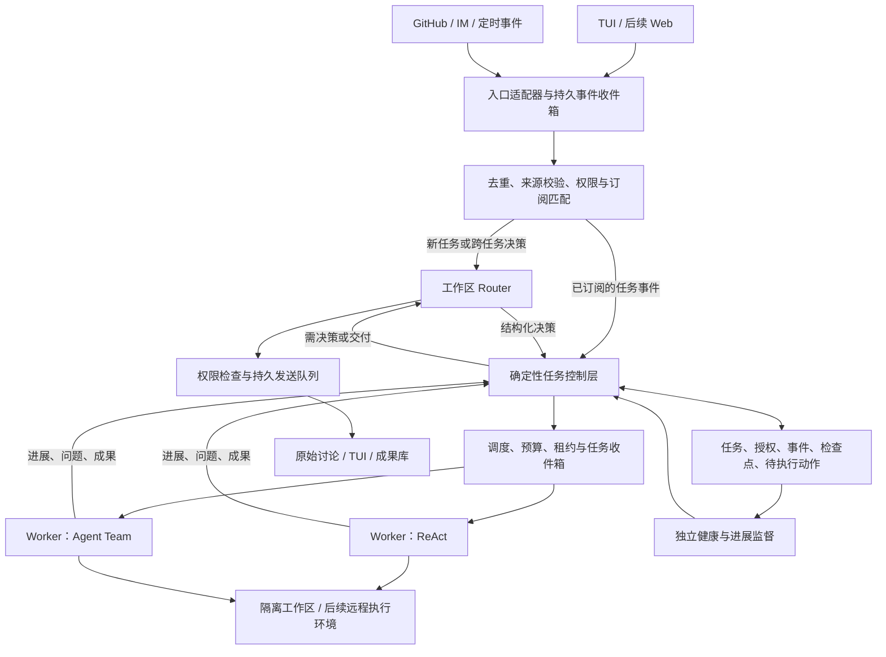

# FrontierAgent Super Agent 产品与架构升级方案

版本：讨论稿 v0.1 · 日期：2026 年 11 月 2 日 · 当前代码基线：`cc5a0e6`

建议将 FrontierAgent 升级为面向研究与研发工作的小团队常驻协作者：用户交付目标、约束和验收标准后，它能跨入口持续推进多个任务，在需要决策或有成果可验收时联系用户。现有 ReAct、Agent Team、工具和评测能力继续作为任务执行基础，在其上新增持久化的任务控制层。

第一阶段以一个团队工作区、少量并行任务、自托管常驻服务为范围，优先打通“提出任务—后台执行—跨入口追问—成果验收—故障恢复”。多租户平台、通用个人助理和大规模跨组织协作留到后续。

## 1 参考设计与升级判断

DeepSeek 的文章将 Super-agent 概括为连续、高效、主动、持久，并提出 Router 与 Worker 分工、事件驱动、异步交互、计算与状态及环境分离、外部 Watchdog 等设计。文章的实验使用合成消息和模拟工作，主要衡量调度协作，不能据此推断真实研究或代码任务的质量收益。[原文](https://mp.weixin.qq.com/s/zoS7GlReWPhfCjENGxXCdg)

开源原型聚焦单个 GitHub 仓库，可接飞书。它已有任务授权、订阅直通、持久化待执行动作、重启恢复和面向人的管理面板；源码中的 `Intake` 实现事件去重与订阅分发，`Effects` 实现提交事务后执行的 SQLite 持久队列。仓库同时明确：公开原型与文章、内部系统并不完全一致，部分设计仍是未来方向。[README](https://github.com/deepseek-ai/dsh-superagent-prototype) · [Intake](https://github.com/deepseek-ai/dsh-superagent-prototype/blob/main/src/core/intake.ts) · [Effects](https://github.com/deepseek-ai/dsh-superagent-prototype/blob/main/src/app/effects.ts)

对 FrontierAgent，最有价值的迁移是职责与生命周期的拆分：**Router 管多个任务之间的连续性，Worker 管一个任务的执行质量，Agent Team 管一个复杂任务内部的协作。**

| 参考机制 | FrontierAgent 的采用方式 |
| --- | --- |
| 常驻 Router 与隔离 Worker | 每个工作区一个逻辑 Router；每项任务独立上下文、执行目录和预算 |
| Trigger、Thread、Ticket、Mandate | 用事件、外部讨论串、业务任务、授权范围连接不同入口；任务独立于执行会话 |
| 订阅直通与两级过滤 | 已明确归属的后续事件直接进入任务；新请求由规则准入与语义路由共同处理 |
| Inline 与 Spill、链式召回 | 复用现有压缩及全文恢复能力，增加可检索的跨任务引用关系 |
| 低打扰、只展示需人处理的事项 | 首页优先展示待决策、待验收和真实阻塞，完整过程按需展开 |
| 存算分离、外部监督 | 先完成可靠的单节点服务，再扩展远程执行环境和独立监督进程 |

原型将上下文投递与授权分开，且采用 `off / observe / auto` 控制推断出的主动任务；这些机制值得复用。其执行器以操作系统用户权限运行，部分交付规则依赖提示词，不能直接作为 FrontierAgent 无人值守的权限边界。[授权模型](https://github.com/deepseek-ai/dsh-superagent-prototype/blob/main/docs/002-authorization.md) · [执行与恢复](https://github.com/deepseek-ai/dsh-superagent-prototype/blob/main/docs/003-execution.md)

## 2 当前基础与实际缺口

| 能力 | 当前实现 | 升级工作 |
| --- | --- | --- |
| 单任务执行 | Stateful ReAct 和 Agent Team；研究、文件、代码相关工具 | 通过统一 Worker 适配器继续调用现有 workflow |
| 单任务内协作 | AgentBus、任务板、分派与报告收集、SpawnGuard | 在外层增加独立任务调度；任务内部仍使用原有协作模型 |
| 用户中途介入 | TUI 能排队接收新指令，在安全步边界注入；可唤醒部分等待 | 增加跨入口持久收件箱、任务定位、取消传播与长命令后台化 |
| 会话保存 | TUI 按完成回合保存历史、journal 和 UI 状态，支持 resume | 增加业务任务、未消费事件、执行尝试、待发送结果的事务性恢复 |
| 任务持久化 | `ProcessManager` 使用内存字典；`state/event_store/sqlite.py` 是 no-op 兼容实现 | 新建真正的业务状态存储，不能将现有模块名视作已有数据库能力 |
| 上下文管理 | 分层压缩、spill 引用、部分工具结果恢复 | 增加带权限边界的任务关系索引、结构化交接和长期决策记录 |
| 运行控制 | 时间与预算限制、重复行为检测、停止信号 | 增加跨任务预算、租约、恢复退避和独立进展监督 |
| 执行环境 | workflow 工具有沙箱策略；TUI 另有 native、bwrap、container 路径 | 无人值守明确要求隔离运行；区分 native 审批与操作系统隔离 |

依据：[框架说明](framework.md)、[Agent Team](../workflows/agent_team/README.md)、[任务管理](../frontier_agent/scheduling/process_manager.py)、[EventStore](../frontier_agent/state/event_store/sqlite.py)、[TUI 存档](../apodex/session.py)、[实时介入](../apodex/steer.py)、[TUI 执行环境](../apodex/README.md#where-commands-run)。

特别需要保留当前包边界：核心 loop 和 AgentBus 已通过适配层引用 `apodex-agent-core`，当前依赖固定为 `0.14.1`。业务调度应放在 FrontierAgent 产品层；只有确需通用的异步工具或回合钩子时，才向共享内核增加能力。[依赖定义](../pyproject.toml) · [loop 适配层](../frontier_agent/core/runtime/loop/agent_loop.py)

## 3 产品定位与核心体验

### 3.1 首批用户与价值

首批用户是同时推进多项研究、实验、文档和研发事务的个人及小团队。核心价值是减少追问进度、搬运背景、重启任务和检查无效输出的人工投入。

建议用三个场景约束产品设计：

| 场景 | 用户体验 | 有效交付 |
| --- | --- | --- |
| 持续研究 | 提交研究目标和材料，后台并行核查；补充材料后继续原任务 | 有来源与未决问题的报告及版本差异 |
| 研究到实现 | 调研方案、完成实验、整理结论；用户可在关键方案处分叉或调整 | 可复现的实验记录、文件成果或代码变更 |
| 研发闭环 | 在 TUI 或 IM 提出问题，后续在 GitHub 评审中继续推进 | 带验证证据的 PR，及明确的评审、合并或关闭结果 |

首轮内测选择研发闭环验证跨入口与恢复机制，同时保留一组研究及文件任务做质量回归。主动研究监测可在第二阶段开放；系统只监听用户配置的来源。

### 3.2 用户面对的对象

产品界面以“工作区—任务—成果”为主线，执行会话作为可展开的诊断信息。

- **工作区**：项目目标、可访问资料、成员权限、接入来源、执行环境和总预算。
- **任务**：要完成的目标、成功标准、负责人、当前阶段、预算和关联讨论。
- **成果**：报告、文件、代码变更、PR 或实验结果，具有版本和验证记录。
- **待处理事项**：必须由人回答的问题、待验收成果、授权请求或无法自愈的阻塞。

每张任务卡应让用户立即知道：正在完成什么、最近有什么实质进展、现在在等谁、还能做什么操作。原有 Agent Team 任务板保留在任务详情内，显示该任务的内部拆解。

### 3.3 关键产品能力

| 能力 | 用户可见行为 | 首期边界 |
| --- | --- | --- |
| 统一交互 | 在 TUI、IM、GitHub 继续同一任务；询问整体进度 | 显式链接、任务编号和已建立订阅优先；歧义时确认归属 |
| 多任务推进 | 后台运行任务 A，同时提交任务 B、调整任务 C | 初期小规模并发，任务可排队，不无限创建 Worker |
| 实时调整 | 修改目标、补充约束、暂停、继续、取消、人工接管 | 操作关联具体任务；取消能阻止后续外部动作 |
| 成果验收 | 查看报告差异、文件预览、代码 diff 和验证证据 | “已生成”与“已验收”分开；文件存在不等于任务完成 |
| 主动协作 | 根据规则静默复现问题、更新研究或准备草稿 | 默认观察模式；执行范围和成本由规则预先约束 |
| 持久运行 | 关闭客户端后任务继续；重连能看到一致状态 | 服务所在机器必须在线；依赖离线设备的任务显示等待设备 |
| 可理解的记忆 | 记住项目决策和任务关系，能解释所依据的来源 | 不将整个团队聊天无差别合并成全局记忆 |
| 可控的成本 | 查看任务、项目和主动工作消耗；设置上限 | 到限保存进度并暂停，扩预算才继续 |

### 3.4 一次完整交互

1. 用户在 TUI 提出：“分析数据导入慢的问题，给出验证过的改进方案；代码修改先做到可评审。”系统记录目标、验收要求和操作范围，简短确认一次。
2. Router 创建任务并分配 Worker。Worker 可选择 ReAct，或在任务内部用 Agent Team 并行定位与实验。
3. 用户在 IM 用任务链接补充“优先兼容旧版本”。系统写入新的任务约束，投递给原 Worker；已有成果标注是否需要重新验证。
4. 同时另一项研究任务继续运行。该问题的详细工具日志不会进入群聊，也不会挤占研究任务上下文。
5. Worker 交付测试结果与 PR。用户在 GitHub 追加评审意见，订阅机制将其送回同一任务，持续更新同一个成果。
6. 服务中断后重启，系统先核对 PR、提交和未完成命令，再恢复执行，避免重复发布。满足约定的验收条件后任务结束。

如果用户说“停掉这个任务”，任务立即进入停止流程，撤销未执行的外部写入并向运行环境发送取消。已经完成的外部操作如实保留；停止不等于自动回滚。

### 3.5 界面与通知

首期扩展现有 Textual / Rich TUI：增加工作区任务列表和待处理事项，任务详情复用现有聊天、工具、文件与 diff 展示。常驻服务和交互客户端解耦，退出界面不结束后台任务。团队采用后再建设共享 Web 面板，使用相同服务接口。

默认只主动通知四类变化：成果就绪、需要决策、实际阻塞、重要失败。过程状态留在任务详情，用户主动询问时随时返回。IM 发简短结论和成果链接；GitHub 保留问题、改动、验证等完整信息；研究报告承载详细分析。

同一事项在多个入口共享处理状态，回答一次即可消除所有入口的待处理提示。涉及私有资料时，只向具备相应权限的目的地发送摘要或链接。

## 4 总体技术架构

建议采用“一个工作区控制面 + 多个隔离执行单元”的架构。常驻指逻辑身份和状态连续，Router 不需要持续占用推理请求。

### 4.1 三种职责严格分开

**Router 负责理解与协调。** 判断请求归属、新建任务、选择 workflow、转交补充信息、汇总状态和组织对外回复。默认使用低延迟模型，复杂歧义可升级。工具集不包含 shell 或直接改文件能力，从能力配置上避免其陷入长任务。

**任务控制层负责事实与约束。** 状态迁移、身份校验、授权、去重、预算、租约、动作入队和审计由确定性代码执行。Router 的结构化输出是待验证的决策，不是数据库事实；模型不能直接宣布自己获得权限或修改预算。

**Worker 负责执行。** 每项任务有隔离上下文和工作区，通过统一适配器运行现有 workflow。复杂任务内部可用 Agent Team；Worker 向控制层提交结构化报告。跨任务协调默认经 Router 或结构化依赖完成，避免所有 Worker 互相广播。

统一对外沟通是产品原则。具体发布报告、更新 PR 等动作可以由 Worker 提出，但应通过受控交付接口执行，使用任务授权、可审计回执和确定的目标地址。

### 4.2 核心状态模型

| 对象 | 持有的核心信息 |
| --- | --- |
| Workspace | 项目、成员权限、来源配置、知识范围、执行环境、预算 |
| Trigger 与 Thread | 不可变来源事件、来源身份及事件 ID；外部讨论串及顺序 |
| Ticket | 用户目标、验收条件、当前约束版本、状态、关联讨论与成果 |
| Mandate | 请求者、允许的资源与动作、预算、有效期、授权依据与策略版本 |
| Assignment | 某次执行的 Worker、workflow、模型、环境、检查点和租约 |
| Subscription | 哪些任务接收哪些讨论的后续事件，区分主任务输入与参考上下文 |
| Artifact | 成果类型、版本、存储位置、来源、验证证据、验收结果 |
| Attention | 必须由谁处理的问题、选项、阻塞关系、所针对的成果或任务版本 |
| Effect 与 Job | 待执行或待发送动作及回执；后台命令及其运行状态 |

业务任务使用新对象 `Ticket`，原有 workflow 的 `Task` 保持单次执行语义，通过 Assignment 关联。一次 Ticket 可以有多次恢复或重新分配，不能用一次 loop 的终止直接代表整个业务任务完成。

建议任务状态为排队、执行中、等待输入、等待外部条件、待验收、已完成、失败、已取消。等待原因单独记录；Worker 的空闲与忙碌独立于业务状态。失败后的重试创建新执行尝试；取消后的重新开工必须有新的明确授权。

### 4.3 事件路由与全局连续性

入口适配器负责认证、增量游标、事件标准化、排除自身回声和写入确认。事件落库后才能推进来源游标；来源事件 ID 和版本组成去重键。

后续事件优先走订阅直通。这里的直通只跳过 LLM 路由，不跳过访问权限和动作授权。普通 CI、评论和参考材料可以改变认知，但不能自行扩大任务范围、发布成果或解除停止状态。超范围输入由 Worker 交回 Router。

Router 以工作区为初始边界，使用单一逻辑写入序列；推理期间积累的普通事件批量处理。取消、权限撤销和明确的人工操作进入高优先级控制通道，不排在常规语义批次之后。

跨入口连续性依靠显式关联、任务索引和结构化决策记录：Thread 可以关联多个任务，一个任务也可以订阅多个 Thread。仅凭主题相似不能自动合并任务。跨平台身份采用显式绑定或各来源独立授权，不能由模型推断“昵称相同即同一人”。

用户改变方向时递增任务约束版本。Worker 报告及待发布动作标记所依据的版本，旧版本成果不得未经检查直接发布；有冲突的多人指令交由任务负责人决策。

### 4.4 持久执行与恢复

首期使用单节点 SQLite 业务库和持久卷，包含任务状态、事件、收件箱、检查点、发送回执与待执行动作。与现有 benchmark 的 no-op EventStore 分离，通过接口接入；不把可关闭的 trace 日志当成可靠状态库。多副本服务阶段再迁移共享数据库和对象存储。

一次状态变更与其引发的动作应在同一事务中记录，提交后再启动 Worker 或发送消息。投递采用至少一次语义，通过幂等键、输入确认和结果回执控制重复；不承诺任意外部系统上的“恰好一次”。

恢复顺序是：加载业务状态，检查未确认动作和实际外部结果，确认旧执行者已停止或失去有效租约，再分配新执行者。命令执行成功但回执丢失时，先查询结果；无法确认且不可安全重试的动作转为待处理事项。

任务挂起不长期占用 LLM 执行槽。人工反馈保留优先容量，避免大量自动任务阻塞用户介入；恢复和重试继续计入原任务预算。

### 4.5 异步工具与并发隔离

现有 TUI 接收输入的能力可以复用，但当前本地 `bash` 仍等待命令返回。新增后台 Job 接口，以 `start / status / cancel` 表达长命令；启动后返回 Job ID，完成后以事件恢复 Worker，用户输入可在下一个安全边界处理。

首期建议每项任务运行于独立进程及隔离目录，编码任务采用独立 worktree。当前 TUI 存在进程级工作目录和环境变量操作，不宜将多任务直接塞入同一进程并依靠上下文变量隔离。

共享资源采用明确的写入所有权：同一分支、PR 或成果版本默认只有一个写入者，其他任务可读取或提交建议。接管时递增执行代次，拒绝旧 Worker 的迟到写入。最终集成通过评审或专门的集成任务完成。

预算同时限制工作区总量、单任务、子 Agent 扇出和主动预研额度。现有 SpawnGuard 管任务内部并行度，外层调度再约束所有 Worker 的总消耗，避免并发相乘失控。

### 4.6 上下文与记忆

采用三层内容管理：当前推理窗口保留近期有效指令、目标和摘要；任务记录保留结构化交接、决策、证据与成果关系；大体积日志、工具结果、附件存入可按 ID 读取的内容库。

建立 `Trigger → Thread → Ticket → Artifact / Assignment` 引用关系，让 Router 能从新消息找回旧任务，而不用反复加载全部历史。复用现有 spill 与结果恢复机制，但迁移至跨进程可访问的稳定引用，并在读取时检查工作区和资料权限。

长期记忆首期只保存有来源的项目决策、显式用户偏好和已验收结论，记录适用范围、时间及被替代关系。权限与预算是结构化约束，不允许仅存在于可能被压缩的自然语言摘要中。全文索引与关联查询先落地，向量检索在召回需求得到验证后再增加。

### 4.7 环境与可靠性

首期在常驻主机上运行控制服务和隔离 Worker，保证客户端断开不影响执行。后续新增 Environment Adapter，将 loop 与实际工具执行环境拆开，支持托管容器、服务器及用户设备。

远程设备通过受认证的连接领取限定工作区、动作和有效期的执行请求，端侧再次校验。凭据由执行端或专用代理使用，尽量不进入模型上下文。设备离线时保留等待状态；只能在环境具备等价输入、依赖与数据时迁移任务，不能假定未提交的本地文件可自动恢复到云端。

监督分两层：确定性的健康检查处理心跳、租约、队列积压和重试；独立的进展监督只对异常任务读取近期轨迹，判断是否重复、偏航或无实质推进。后者可以建议重规划、切换执行者或暂停，但不能自行扩大授权、提高预算或修改安全策略。恢复次数有上限，并有退避与冷却，防止监督器制造无限重试。

## 5 主动能力与授权设计

主动性按规则逐步开放。采用与原型一致的三个模式：`off` 仅处理明确请求；`observe` 记录潜在行动但不执行；`auto` 在已批准规则范围内执行。显式请求始终经过其自身的权限与资源检查。

每条主动规则至少包含监听范围、匹配条件、允许行为、预算、交付条件、通知方式和去重周期。例如：“监听本项目 CI；同类失败先做一次隔离复现；最多使用指定预算；只有获得可验证修复才生成可评审成果。”

静默预研只在预授权范围内进行。后台读取公开材料、实验、生成草稿和对外发消息、提交 PR、部署是不同权限。是否允许自动创建 PR 由规则明确决定；合并和部署另行授权，并由执行网关与目标平台规则共同约束。

策略收紧或授权撤销后，立即阻止新的越权动作，在安全边界停止相关执行并保留检查点。历史已完成操作不自动回滚。这是面向长期服务的建议，比只通知 Worker 策略变化更严格。

无人值守场景不将 TUI native 模式、命令黑名单或 worktree 视为沙箱。执行权限必须由隔离环境、限定凭据和工具边界共同落实；网页、群聊和仓库文件里的文字均不能改写这些权限。

## 6 代码组织与迁移策略

建议在产品层新增以下职责模块，具体命名在详细设计阶段确定：

| 模块 | 责任 | 与当前实现的关系 |
| --- | --- | --- |
| `frontier_agent/superagent/domain/` | 业务任务、授权、订阅、状态迁移 | 新增，独立于现有单次执行 Task |
| `frontier_agent/superagent/service/` | Router、入口、持久收件箱、调度与发送队列 | 新增长期运行服务 |
| `frontier_agent/superagent/storage/` | 事务存储、检查点、内容引用 | 新增真实存储实现 |
| `frontier_agent/superagent/executors/` | 将 Assignment 映射到 ReAct 或 Agent Team | 复用 workflows、预算和报告能力 |
| `frontier_agent/superagent/environments/` | 隔离任务环境与后续远程执行 | 接入已有沙箱策略，补充后台 Job 生命周期 |
| `apodex/` 的客户端适配 | 任务列表、待处理、连接服务、任务操作 | 复用 Textual / Rich；保留现有本地模式 |

迁移采用增量方式：先建立服务到现有 workflow 的适配器，再将 TUI 接入服务，随后加入外部来源。单次 CLI 与 benchmark 继续使用原运行方式；新能力显式启用，避免持久在线语义改变现有评测行为。

不建议直接移植 TypeScript 原型或更换当前 runtime。应复用其领域模型与可靠投递原则，在现有 Python 产品层实现，并以契约测试约束 Worker 接口。

## 7 分阶段交付与验收

以下是按依赖排列的交付阶段，不预设人员和工期。P0 与 P1 合起来构成首个可内测的 Super Agent 闭环。

| 阶段 | 交付范围 | 进入下一阶段的条件 |
| --- | --- | --- |
| P0 持久多任务基础 | 常驻服务、业务任务库、执行尝试、隔离 Worker、后台 Job、预算、TUI 任务列表、恢复 | 多项任务可同时推进；客户端退出仍运行；进程重启后目标和未读输入保留；重复事件不重复建任务 |
| P1 跨入口工作闭环 | GitHub 和一个 IM 入口、Router、订阅直通、成果与待处理事项、统一交付 | IM 发起后能在 GitHub 继续；范围变更不重复开工；验收状态一致；撤销后不再发起外部动作 |
| P2 有边界的主动协作 | observe 与 auto、规则版本、主动预算、结构化记忆、独立进展监督 | 观察记录达到试点认可的准确性；故障恢复有上限；人工通知对应可用成果或必要决策 |
| P3 多环境与团队规模化 | 远程设备适配、共享 Web 面板、多服务实例、共享数据库与内容库 | 设备断连不丢任务；权限隔离通过验证；单节点瓶颈被实测确认后才扩容 |

首期暂不投入开放式 A2A、无限层级 Agent、自动修改自身系统策略、无边界组织记忆、通用个人助理或全功能项目管理系统。

### 7.1 衡量产品是否有效

主指标建议是**每单位人工投入完成并被验收的任务数**。同时观察每个任务的人工干预次数、首次有效回应时间、完成时间分位数、交付返工率和模型及工具成本。

主动工作单独看观察候选的准确率、被采纳的成果占比、无效通知率与额外成本，避免用“自动启动任务数”衡量成功。上线前使用团队实际任务建立基线，再确定改善幅度；这些指标不是当前性能承诺。

### 7.2 验证方法

建立事件回放测试集，包含明确请求、闲聊、CI、评审、重复事件、乱序消息、任务改向和取消。对比当前运行方式、新增 Router 但无直通、完整订阅直通三组；固定模型、执行任务、权限和预算，区分路由开销与任务质量。

必须覆盖的恢复场景包括：事件入库前后崩溃、命令完成但回执丢失、消息已发出但发送回执未提交、Worker 与监督器同时重启、设备离线重连、取消后收到迟到结果。检查的是业务事实和外部副作用，而不只是进程能重新启动。

真实任务评测沿用 FrontierAgent 的研究和文件能力验证，再增加可复现的研发任务；合成负载用于调度测试，两者分别报告。上线硬门槛包括：无越权动作、取消不被自动唤醒绕过、重复事件不重复创建任务、未确认副作用不被盲目重试。

## 8 建议优先确定的产品决策

本方案采用以下默认方向，可据试点结果调整：首批服务个人与小团队；以工作区为上下文和授权边界；以常驻自托管服务起步；TUI 优先、GitHub 与一个 IM 作为跨入口试点；主动工作先 observe；成果验收由任务类型决定；无人值守执行采用隔离环境。

最先投入的工程工作应是 **Ticket 与 Assignment 的生命周期、可靠事件投递、Worker 恢复、任务级授权和成果验收**。这些基础完成后，Router 才能持续代表用户推进工作，主动规则和更多入口才能带来稳定收益。
